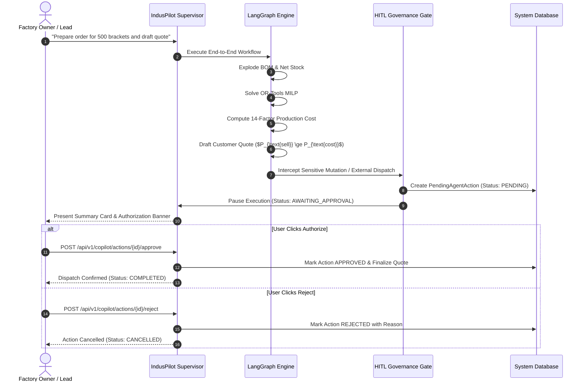

# IndusPilot Commercial Approval Governance & Human-in-the-Loop Policies

## Principles of Agentic Governance

In manufacturing procurement, autonomous software cannot be permitted to execute unilateral commercial actions that commit company funds, alter inventory valuation, or issue legally binding quotes to clients without human executive oversight.

IndusPilot enforces **Human-in-the-Loop (HITL) Checkpoints** directly into its LangGraph state graph.



---

## Operations Requiring Mandatory Executive Approval

1. **Customer Quotation Dispatch (`EXTERNAL_ACTION`)**:
   - Any quote dispatched to an external client requires approval from the Commercial Director or Plant Head.
2. **Loss-Making or Below-Target Margin Contracts**:
   - If projected gross margin falls below the executive minimum threshold (e.g., $< 15\%$) or break-even price, the quotation is automatically locked in `APPROVAL_REQUIRED` state.
3. **Purchase Requisition Commitment (`SENSITIVE_MUTATION`)**:
   - Committing funds above ₹1,00,000 for raw material purchase orders requires confirmation.
4. **Physical Inventory Stock Overrides (`SENSITIVE_MUTATION`)**:
   - Manual inventory adjustments require written audit rationale.

---

## Audit Ledger Schema (`pending_agent_actions`)

```sql
CREATE TABLE pending_agent_actions (
    id VARCHAR PRIMARY KEY,
    run_id VARCHAR NOT NULL REFERENCES agent_runs(id),
    organization_id VARCHAR NOT NULL REFERENCES organisations(id),
    conversation_id VARCHAR,
    action_type VARCHAR(100) NOT NULL,
    agent_name VARCHAR(100) NOT NULL,
    title VARCHAR(255) NOT NULL,
    description TEXT NOT NULL,
    proposed_payload_json JSON NOT NULL,
    financial_impact_summary VARCHAR(255),
    status VARCHAR(50) DEFAULT 'PENDING',
    decision_by VARCHAR(100),
    decision_reason TEXT,
    decided_at TIMESTAMP,
    created_at TIMESTAMP DEFAULT CURRENT_TIMESTAMP
);
```

