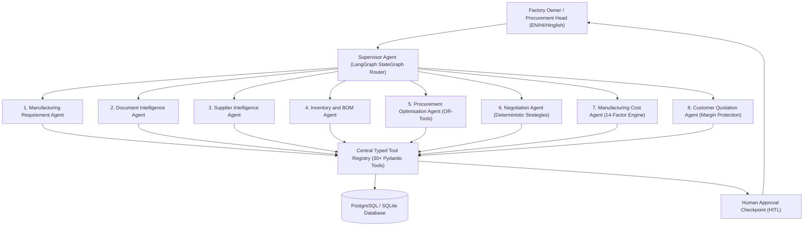

# IndusPilot Multi-Agent Architecture & Supervisor System

## Executive Overview

The **IndusPilot Multi-Agent Supervisor System** is an enterprise-grade agentic coordination layer designed specifically for manufacturing micro-, small-, and medium-sized enterprises (MSMEs). Rather than forcing a factory owner or procurement lead to navigate across disparate screens—BOM Explosion, Inventory Netting, Supplier Comparison, MILP Optimization, Cost Breakdown, Negotiation, and Customer Quoting—IndusPilot provides an intelligent conversational interface capable of orchestrating complex, multi-stage business operations through autonomous specialized agents.

---

## 9 Specialized Engineering Agents

### 1. Supervisor Agent
- **Role:** Central orchestrator, natural language parser, and response synthesizer.
- **Responsibilities:**
  - Classifies user intent from natural language (English, Hindi, Hinglish).
  - Maintains conversation context memory across multi-turn interactions.
  - Dynamically builds execution subgraphs using LangGraph.
  - Generates comprehensive business summaries paired with rich structured response cards.
  - Enforces governance policies and pauses execution when sensitive mutations require executive approval.

### 2. Manufacturing Requirement Agent
- **Role:** Product specification and manufacturing intent analyst.
- **Responsibilities:**
  - Resolves finished goods codes (e.g., `IND-BRK-SS304`).
  - Validates production volumes, scrap allowances, and target completion deadlines.
  - Extracts budget caps and target gross margin thresholds from user instructions.

### 3. Document Intelligence Agent
- **Role:** Unstructured quotation and invoice extraction.
- **Responsibilities:**
  - Ingests uploaded PDF and Excel quotation files.
  - Executes OCR and document parsing pipelines.
  - Normalizes line items, units of measure, and commercial freight/tax terms into verified quotation records.

### 4. Supplier Intelligence Agent
- **Role:** Vendor evaluation, ranking, and eligibility verification.
- **Responsibilities:**
  - Matches requested specifications against supplier catalogues using token-similarity and grade equivalency tables.
  - Ranks suppliers using the canonical 5-factor composite scoring model (Cost Competitiveness 35%, Quality 25%, Delivery Reliability 15%, Lead Time 15%, Payment Terms Flexibility 10%).
  - Evaluates MOQ compliance and geographical delivery capabilities.

### 5. Inventory & BOM Agent
- **Role:** Bill of Materials explosion and MRP stock netting.
- **Responsibilities:**
  - Recursively explodes multi-level BOMs into direct raw material components with scrap multipliers.
  - Queries physical warehouse inventory, reserved stock, and incoming orders.
  - Computes exact net material purchasing shortages:
    $$\text{Net Shortage} = \max\left(0, \text{Gross Required} + \text{Safety Stock} - (\text{Physical Stock} - \text{Reserved})\right)$$

### 6. Procurement Optimisation Agent
- **Role:** Google OR-Tools Mixed-Integer Linear Programming (MILP) solver.
- **Responsibilities:**
  - Formulates multi-supplier, multi-material allocation mathematical models.
  - Solves for minimum total landed cost subject to MOQ, supplier capacity, and budget limits.
  - Benchmarks optimal allocations against single-source median baselines to prove verifiable rupee savings.

### 7. Negotiation Agent
- **Role:** Vendor counter-offer formulation and multi-round concession analysis.
- **Responsibilities:**
  - Identifies negotiation opportunities based on volume tiering and historical cohort pricing.
  - Generates structured, professional counter-offer emails in English, Hindi, or Hinglish.
  - Simulates vendor concession curves under deterministic exponential decay models `[SIMULATED]`.

### 8. Manufacturing Cost Agent
- **Role:** Deterministic 14-factor production costing engine.
- **Responsibilities:**
  - Calculates audited unit manufacturing costs across raw materials, primary processing, secondary finishing, direct labor, machine wear, power/electricity, tooling, packaging, and allocated factory overhead.
  - Computes break-even factory prices using strict Python `Decimal` (`ROUND_HALF_UP`) math.

### 9. Customer Quotation Agent
- **Role:** Commercial quotation generation and automated margin protection.
- **Responsibilities:**
  - Computes target selling prices to achieve executive margin targets:
    $$\text{Unit Selling Price} = \frac{\text{Unit Break-Even Cost}}{1 - \frac{\text{Gross Margin \%}}{100}}$$
  - Enforces automatic loss-making contract protection: rejects or halts any quote where selling price falls below audited unit break-even cost.
  - Generates tamper-evident commercial PDF quotes with Indian Rupee (₹) formatting.

---

## Zero-Credential Deterministic Fallback (`DEMO MODE`)

To ensure flawless offline demonstration and CI/CD testing without external API key dependencies:
1. When neither `GEMINI_API_KEY` nor `OPENAI_API_KEY` is provided, the platform automatically activates `DemoNLUProvider`.
2. The `DemoNLUProvider` executes deterministic regex and semantic keyword parsing for English, Hindi, and Hinglish.
3. Every numeric computation is routed directly through backend Python math engines (`Decimal`), guaranteeing exact, reproducible results.

