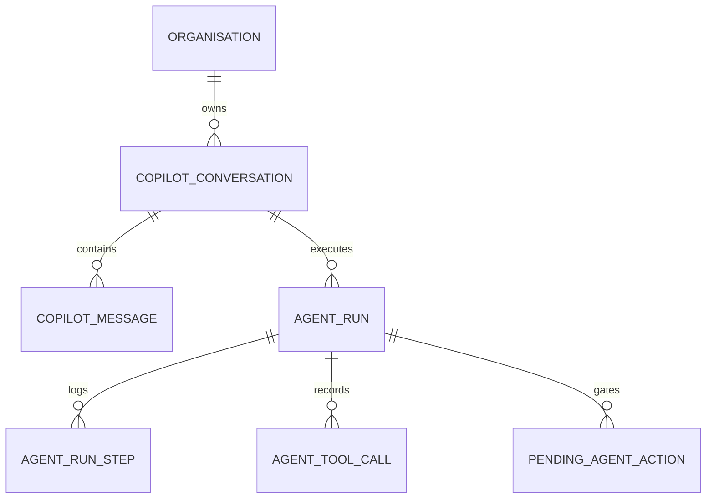

# IndusPilot Copilot Conversational Memory & State Persistence

## Memory Architecture

The IndusPilot AI Copilot maintains stateful, persistent multi-turn conversations backed by relational PostgreSQL/SQLite tables. Unlike stateless chatbots that forget context between prompts, IndusPilot preserves:
1. Product identification (`product_code`, `product_id`).
2. Order batch sizes (`production_quantity`).
3. Raw material grades (`material_grade`).
4. Commercial thresholds (`budget_limit`, `target_margin_pct`).
5. Chronological message history with associated agent telemetry runs.



---

## Database Entities

### 1. `copilot_conversations`
- `id` (UUID): Primary key.
- `organization_id` (String): Multi-tenant scoping key.
- `title` (String): Auto-generated or user-edited conversation title.
- `is_archived` (Boolean): Soft-deletion flag.
- `context_state_json` (JSON): Serialized business parameter memory:
  ```json
  {
    "product_code": "IND-BRK-SS304",
    "material_grade": "SS304",
    "quantity": 500.0,
    "budget_limit": 500000.0,
    "target_margin_pct": 20.0
  }
  ```

### 2. `copilot_messages`
- `id` (UUID): Primary key.
- `conversation_id` (UUID): Foreign key to conversation.
- `organization_id` (String): Multi-tenant identifier.
- `role` (String): `user` or `assistant`.
- `agent_name` (String): Specialized agent that answered (e.g., `Supervisor Agent`, `Procurement Planning Agent`).
- `content` (Text): Markdown-formatted response.
- `structured_data_json` (JSON): Typed card data rendered in UI.
- `tool_calls_json` (JSON): Summary of tools executed during this turn.
- `run_id` (String): Foreign key to `agent_runs`.
- `requires_human_approval` (Boolean): Commercial authorization indicator.
- `pending_action_id` (String): Reference to paused action if applicable.

---

## Context Retention Example

### Turn 1:
- **User:** "Check inventory shortage for 500 stainless steel industrial brackets"
- **System Memory Updated:**
  - `quantity`: 500.0
  - `product_code`: "IND-BRK-SS304"
  - `material_grade`: "SS304"
- **Agent Output:** Net shortage is 750.0 kg of SS304 plate.

### Turn 2 (Follow-Up):
- **User:** "Calculate manufacturing costing breakdown for this batch"
- **System Resolution:**
  - Detects absence of explicit quantity or product in Turn 2.
  - Ingests `context_state_json` from Turn 1.
  - Automatically calculates 14-factor production costing for 500 units of `IND-BRK-SS304` without asking the user to repeat parameters.

