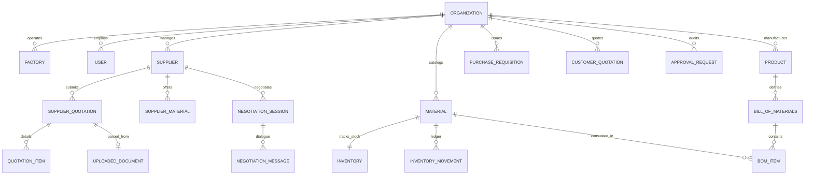

# IndusPilot — Database Schema & Data Dictionary

**System:** IndusPilot (Agentic AI for Manufacturing Procurement & Quotation Optimisation)  
**Hackathon Target:** Tech4Bharat 2026 (Problem Statement 4.1)  
**Architecture Version:** 1.0.0 Relational & Multi-Tenant  

---

## 1. Entity-Relationship Overview

IndusPilot implements a strictly typed relational schema designed for multi-tenant industrial operations. Every operational table is partitioned or foreign-keyed by `organization_id` to prevent cross-tenant data leakage.

---

## 2. Table Specifications & Data Dictionaries

### 2.1 Identity & Organization

#### `organisations`
Stores enterprise tenant profiles, currency standards, and default manufacturing parameters.
| Column | Type | Constraints | Description |
| :--- | :--- | :--- | :--- |
| `id` | VARCHAR(36) | PRIMARY KEY | Unique tenant identifier (UUID) |
| `name` | VARCHAR(255) | NOT NULL | Registered manufacturing enterprise name |
| `slug` | VARCHAR(100) | UNIQUE, INDEX | URL-safe tenant handle |
| `manufacturing_category` | VARCHAR(100) | DEFAULT 'Metal Fabrication' | Sector classification |
| `currency` | VARCHAR(10) | DEFAULT 'INR' | Base transactional currency |
| `currency_symbol` | VARCHAR(5) | DEFAULT '₹' | Display symbol |
| `tax_id` | VARCHAR(50) | NULLABLE | GSTIN / Corporate Tax Identification Number |
| `default_overhead_pct` | FLOAT | DEFAULT 12.0 | Default factory overhead percentage |
| `created_at` | TIMESTAMP | DEFAULT UTC | Record creation timestamp |

#### `factories`
Manufacturing premises, production capacity ceilings, and local utility cost benchmarks.
| Column | Type | Constraints | Description |
| :--- | :--- | :--- | :--- |
| `id` | VARCHAR(36) | PRIMARY KEY | Factory identifier |
| `organization_id` | VARCHAR(36) | FOREIGN KEY $\to$ organisations.id | Owning tenant |
| `name` | VARCHAR(255) | NOT NULL | Plant designation |
| `location` | VARCHAR(255) | NOT NULL | Physical plant address |
| `capacity_monthly_hours`| FLOAT | DEFAULT 1200.0 | Available monthly machine/operator hours |
| `electricity_tariff_kwh`| FLOAT | DEFAULT 8.50 | Local industrial tariff per kWh in INR |
| `default_labor_rate_hr` | FLOAT | DEFAULT 180.0 | Standard operator hourly rate in INR |

---

### 2.2 Suppliers & Performance Intelligence

#### `suppliers`
Vendor profiles, compliance credentials, and historical reliability ratings.
| Column | Type | Constraints | Description |
| :--- | :--- | :--- | :--- |
| `id` | VARCHAR(36) | PRIMARY KEY | Supplier identifier |
| `organization_id` | VARCHAR(36) | FOREIGN KEY $\to$ organisations.id | Tenant scope |
| `name` | VARCHAR(255) | NOT NULL | Vendor company name |
| `contact_person` | VARCHAR(255) | NULLABLE | Primary commercial point of contact |
| `email` | VARCHAR(255) | NULLABLE | Sales inquiry email |
| `phone` | VARCHAR(50) | NULLABLE | Contact telephone |
| `city` / `state` | VARCHAR(100) | NULLABLE | Geographic dispatch node |
| `gst_number` | VARCHAR(50) | NULLABLE | Vendor GSTIN |
| `quality_rating` | FLOAT | DEFAULT 4.2 | Quality rating (0.0 to 5.0) |
| `reliability_score` | FLOAT | DEFAULT 85.0 | Historical reliability percentage (0 to 100) |
| `on_time_delivery_pct` | FLOAT | DEFAULT 90.0 | On-time delivery rate percentage |
| `payment_terms_days` | INTEGER | DEFAULT 30 | Standard commercial credit days |
| `is_simulated` | BOOLEAN | DEFAULT TRUE | Tags synthetic demonstration vendors |

---

### 2.3 Materials & Inventory Management

#### `materials`
Raw materials, standard alloys, fasteners, and consumables catalog.
| Column | Type | Constraints | Description |
| :--- | :--- | :--- | :--- |
| `id` | VARCHAR(36) | PRIMARY KEY | Material identifier |
| `organization_id` | VARCHAR(36) | FOREIGN KEY $\to$ organisations.id | Tenant scope |
| `code` | VARCHAR(100) | INDEX, NOT NULL | Material SKU / Internal part code |
| `name` | VARCHAR(255) | NOT NULL | Material description |
| `category` | VARCHAR(100) | DEFAULT 'Sheet Metal' | Raw Material classification |
| `grade` | VARCHAR(100) | NULLABLE | Chemical / Metallurgical grade (e.g. SS304 2B) |
| `unit` | VARCHAR(50) | DEFAULT 'kg' | Primary measurement unit (kg, meter, nos) |
| `density_g_cm3` | FLOAT | NULLABLE | Physical material density |
| `standard_cost` | FLOAT | DEFAULT 0.0 | Standard accounting benchmark cost per unit |

#### `inventory`
Warehouse stock levels, reserved quantities, and safety replenishment thresholds.
| Column | Type | Constraints | Description |
| :--- | :--- | :--- | :--- |
| `id` | VARCHAR(36) | PRIMARY KEY | Inventory item identifier |
| `organization_id` | VARCHAR(36) | FOREIGN KEY $\to$ organisations.id | Tenant scope |
| `material_id` | VARCHAR(36) | FOREIGN KEY $\to$ materials.id, UNIQUE | Associated material |
| `current_stock` | FLOAT | DEFAULT 0.0 | Physical stock present in warehouse |
| `reserved_stock` | FLOAT | DEFAULT 0.0 | Stock earmarked for scheduled production jobs |
| `incoming_stock` | FLOAT | DEFAULT 0.0 | Confirmed open purchase orders in transit |
| `safety_stock` | FLOAT | DEFAULT 50.0 | Buffer stock requirement |
| `reorder_level` | FLOAT | DEFAULT 100.0 | Reorder trigger threshold |
| `warehouse_location`| VARCHAR(100) | DEFAULT 'Rack A-1' | Physical bin / bay location |

---

### 2.4 Products & Bill of Materials (BOM)

#### `products`
Manufactured assemblies and finished goods.
| Column | Type | Constraints | Description |
| :--- | :--- | :--- | :--- |
| `id` | VARCHAR(36) | PRIMARY KEY | Product identifier |
| `organization_id` | VARCHAR(36) | FOREIGN KEY $\to$ organisations.id | Tenant scope |
| `code` | VARCHAR(100) | INDEX, NOT NULL | Finished part code (e.g. SS304-BRK-500) |
| `name` | VARCHAR(255) | NOT NULL | Finished product title |
| `category` | VARCHAR(100) | DEFAULT 'Fabrication' | Finished good product category |

#### `bills_of_materials` & `bom_items`
Hierarchical component explosion with scrap/wastage allowances.
| Column | Type | Constraints | Description |
| :--- | :--- | :--- | :--- |
| `bom_id` | VARCHAR(36) | FOREIGN KEY $\to$ bills_of_materials.id | Parent BOM |
| `material_id` | VARCHAR(36) | FOREIGN KEY $\to$ materials.id | Input raw material component |
| `quantity_per_unit` | FLOAT | NOT NULL | Net quantity required for 1 finished unit |
| `unit` | VARCHAR(50) | DEFAULT 'kg' | Unit of consumption |
| `wastage_pct` | FLOAT | DEFAULT 5.0 | Scrap, cutting, or stamping yield loss % |
| `process_stage` | VARCHAR(100) | DEFAULT 'Cutting' | Manufacturing process center |

---

### 2.5 Quotation Intelligence & Document Processing

#### `uploaded_documents`
OCR processing ledger, file locations, and extraction quality scores.
| Column | Type | Constraints | Description |
| :--- | :--- | :--- | :--- |
| `id` | VARCHAR(36) | PRIMARY KEY | Document identifier |
| `filename` | VARCHAR(255) | NOT NULL | Uploaded file name |
| `file_path` | VARCHAR(500) | NOT NULL | Secure path in storage volume |
| `file_type` | VARCHAR(50) | NOT NULL | PDF, XLSX, CSV, IMAGE |
| `confidence_score`| FLOAT | DEFAULT 0.0 | OCR extraction confidence (0.0 to 1.0) |
| `status` | VARCHAR(50) | DEFAULT 'PENDING_REVIEW' | VERIFIED, QUARANTINED, REJECTED |

#### `supplier_quotations` & `quotation_items`
Structured vendor quotation records including tax inclusivity and freight charges.
| Column | Type | Constraints | Description |
| :--- | :--- | :--- | :--- |
| `id` | VARCHAR(36) | PRIMARY KEY | Quotation identifier |
| `supplier_id` | VARCHAR(36) | FOREIGN KEY $\to$ suppliers.id | Issuing vendor |
| `quotation_number` | VARCHAR(100) | NOT NULL | Vendor invoice/quote reference |
| `subtotal` | FLOAT | DEFAULT 0.0 | Sum of line items before tax |
| `tax_amount` | FLOAT | DEFAULT 0.0 | Calculated tax (GST) |
| `tax_pct` | FLOAT | DEFAULT 18.0 | Applied GST % |
| `freight_cost` | FLOAT | DEFAULT 0.0 | Inbound freight/logistics charge |
| `is_tax_inclusive` | BOOLEAN | DEFAULT FALSE | Flag preventing tax double-counting |
| `total_amount` | FLOAT | DEFAULT 0.0 | Total landed base cost |
| `status` | VARCHAR(50) | DEFAULT 'DRAFT' | VERIFIED, QUARANTINED, ARCHIVED |

---

### 2.6 Autonomous Negotiation State Machine

#### `negotiation_sessions` & `negotiation_messages`
Multi-turn commercial negotiation dialogues, target price benchmarks, and simulated responses.
| Column | Type | Constraints | Description |
| :--- | :--- | :--- | :--- |
| `id` | VARCHAR(36) | PRIMARY KEY | Session identifier |
| `supplier_id` | VARCHAR(36) | FOREIGN KEY $\to$ suppliers.id | Target vendor |
| `material_name` | VARCHAR(255) | NOT NULL | Subject material |
| `quantity` | FLOAT | DEFAULT 1.0 | Order batch quantity |
| `original_unit_price`| FLOAT | NOT NULL | Initial quoted price |
| `target_unit_price`| FLOAT | NOT NULL | Desired buyer counter price |
| `current_offered_price`| FLOAT | NOT NULL | Active prevailing rate after rounds |
| `status` | VARCHAR(50) | DEFAULT 'DRAFT' | State machine status (DRAFT to CLOSED) |
| `simulation_mode` | BOOLEAN | DEFAULT TRUE | Simulation mode guardrail |

---

### 2.7 Customer Quotations & Approvals

#### `customer_quotations`
Downstream customer sales proposals with profit margin guardrails.
| Column | Type | Constraints | Description |
| :--- | :--- | :--- | :--- |
| `id` | VARCHAR(36) | PRIMARY KEY | Customer quotation identifier |
| `quote_number` | VARCHAR(100) | UNIQUE, NOT NULL | Client quote code (e.g. CQ-2026-OCT-5001) |
| `customer_name` | VARCHAR(255) | NOT NULL | Client contact name |
| `customer_company`| VARCHAR(255) | NULLABLE | Client enterprise |
| `unit_production_cost`| FLOAT | NOT NULL | Audited manufacturing cost per unit |
| `unit_selling_price`| FLOAT | NOT NULL | Quoted selling price per unit |
| `total_amount` | FLOAT | NOT NULL | Total gross order value including tax |
| `margin_pct` | FLOAT | NOT NULL | Projected gross profit margin percentage |
| `is_loss_making` | BOOLEAN | DEFAULT FALSE | Loss-making underpricing alert flag |

#### `approval_requests`
Mandatory human authorization checkpoints before dispatching purchase orders or quotes.
| Column | Type | Constraints | Description |
| :--- | :--- | :--- | :--- |
| `id` | VARCHAR(36) | PRIMARY KEY | Approval request identifier |
| `request_type` | VARCHAR(50) | NOT NULL | NEGOTIATION_DISPATCH, PURCHASE_ORDER, CUSTOMER_QUOTE |
| `entity_id` | VARCHAR(100) | NOT NULL | ID of target entity requiring authorization |
| `requested_by` | VARCHAR(255) | DEFAULT 'IndusPilot Agent' | Originating agent |
| `details_json` | JSON | NOT NULL | Complete commercial payload for human review |
| `status` | VARCHAR(50) | DEFAULT 'PENDING' | PENDING, APPROVED, REJECTED |
| `decision_reason` | TEXT | NULLABLE | Human operator explanation |
| `decided_at` | TIMESTAMP | NULLABLE | Timestamp of approval decision |

