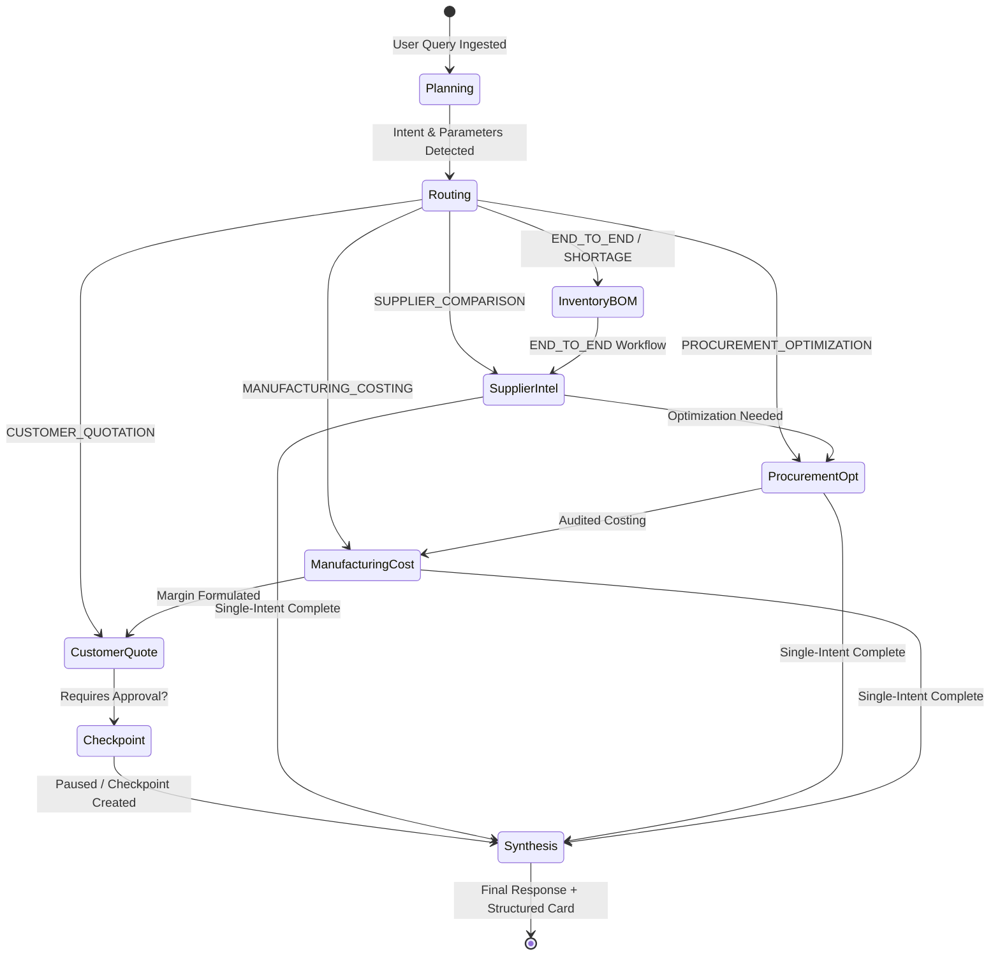

# IndusPilot LangGraph Workflows & State Machine Architecture

## LangGraph StateGraph Architecture

IndusPilot implements **LangGraph** (`langgraph` v1.2.19, `langchain-core` v1.7.4) as the core state-machine execution framework for multi-agent manufacturing orchestration.

The entire workflow is represented as a directed graph where:
- State transitions are managed through a centralized typed TypedDict: `CopilotWorkflowState`.
- Conditional edges route execution dynamically based on user intent and conversational context.
- Execution steps are logged into PostgreSQL/SQLite telemetry tables (`agent_runs`, `agent_run_steps`, `agent_tool_calls`).



---

## State Schema (`CopilotWorkflowState`)

```python
class CopilotWorkflowState(TypedDict):
    conversation_id: str
    run_id: str
    org_id: str
    user_id: Optional[str]
    query: str
    intent: str                          # e.g., END_TO_END_MANUFACTURING_WORKFLOW
    active_agent: str                    # Currently executing agent
    selected_agents: List[str]          # Sequence of agents involved
    parameters: Dict[str, Any]          # Extracted params (qty, budget, margin, etc.)
    context_data: Dict[str, Any]        # Session memory from previous turns
    tool_results: Dict[str, Any]        # Structured data from tools
    step_trace: List[Dict[str, Any]]    # Chronological execution telemetry
    requires_approval: bool             # Human-in-the-loop flag
    pending_action: Optional[Dict[str, Any]] # Paused commercial action
    final_response: Optional[str]       # Synthesized natural language markdown
    structured_card: Optional[Dict[str, Any]] # UI component data
    status: str                         # IN_PROGRESS, COMPLETED, AWAITING_APPROVAL
```

---

## Graph Node Definitions

### 1. `planning_node`
- Extracts intent, product codes, quantities, margins, and budget limits.
- Evaluates follow-up context (e.g., "What if we increase to 800 units?").
- Records `PLANNING` telemetry step.

### 2. `routing_node`
- Evaluates `state["intent"]` to determine downstream node sequence.
- Returns target node name or enters the end-to-end composite pipeline.

### 3. `inventory_bom_node`
- Invokes `calculate_bom_requirements` and `calculate_material_shortages`.
- Stores exploded components and critical shortages in `state["tool_results"]["shortages"]`.

### 4. `supplier_intel_node`
- Discovers verified quotation candidates via `list_supplier_quotations`.
- Executes 100-point composite scoring comparison via `compare_supplier_quotations`.

### 5. `procurement_opt_node`
- Formulates multi-supplier MILP allocation model via `create_procurement_plan`.
- Solves using Google OR-Tools and records solver status, total landed cost, and baseline comparison.

### 6. `manufacturing_cost_node`
- Executes 14-factor costing engine via `calculate_manufacturing_cost`.
- Calculates break-even price and suggested selling price at target margin.

### 7. `customer_quote_node`
- Validates loss-making contract guard ($P_{\text{sell}} \ge P_{\text{break-even}}$).
- Creates commercial quotation record via `create_customer_quotation_draft`.
- Sets `requires_approval = True` and writes `PendingAgentAction` in `PENDING` state.

### 8. `synthesis_node`
- Consolidates all execution traces into an executive business summary.
- Generates structured payload card (`END_TO_END_SUMMARY`, `SUPPLIER_COMPARISON`, `INVENTORY_SHORTAGE`, `COST_BREAKDOWN`, or `PROCUREMENT_PLAN`).

---

## Checkpointing and Human-in-the-Loop Governance

When a workflow transitions into an approval-gated state:
1. `customer_quote_node` creates a record in `pending_agent_actions`.
2. `AgentRun.status` is set to `AWAITING_APPROVAL`.
3. The workflow pauses execution and returns the response immediately to the user with an interactive authorization banner.
4. When the user clicks **Authorize & Dispatch**, the backend executes `/api/v1/copilot/actions/{id}/approve`, marks the quote `APPROVED`, and finalizes the run telemetry.

