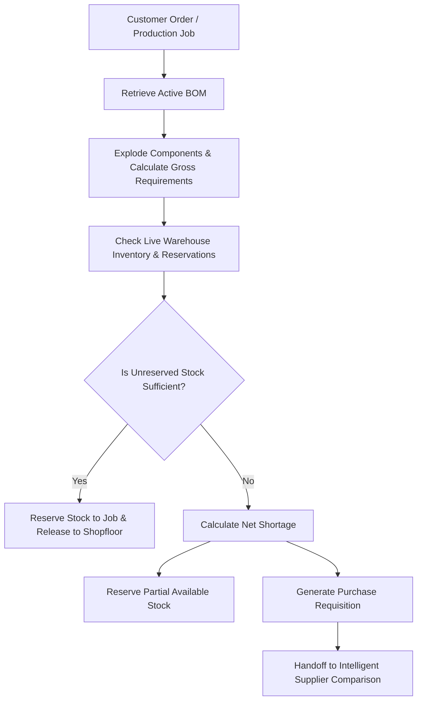

# IndusPilot — Material Requirement Planning (MRP) & Procurement Handoff

## 1. Overview & Workflow

Material Requirement Planning (MRP) bridges the gap between what a customer wants to manufacture and what the procurement department needs to purchase.

The central flow in IndusPilot is:

---

## 2. Inventory Netting Mathematics

For each BOM component $i$ in a production run of $N$ finished units:

1. **Calculate Gross Requirement ($G_i$)**:
   - If additive scrap method:
     $$G_i = N \times q_i \times \left(1 + \frac{s_i}{100}\right)$$
   - If yield-based method:
     $$G_i = \frac{N \times q_i}{\frac{y_i}{100}}$$
   where $q_i$ is net quantity per finished unit, $s_i$ is scrap percentage, and $y_i$ is expected yield percentage.

2. **Retrieve Available Stock ($A_i$)**:
   $$A_i = \max(0, \text{Physical Stock}_i - \text{Reserved Stock}_i)$$

3. **Determine Net Shortage ($S_i$)**:
   $$S_i = \begin{cases} 
   0, & \text{if } A_i \ge G_i \\
   G_i - A_i, & \text{if } A_i < G_i
   \end{cases}$$

4. **Determine Allocatable Reservation ($R_i$)**:
   $$R_i = \min(A_i, G_i)$$

---

## 3. Production Job Lifecycle & Status Transitions

IndusPilot tracks manufacturing jobs through formal lifecycle stages:
- `PLANNED`: Job created with batch size and target completion date.
- `AWAITING_MATERIALS`: MRP material check detected shortages; stock reserved where possible; purchase requisitions dispatched to procurement.
- `READY_TO_RELEASE`: All required materials are 100% on-hand and reserved. Ready for CNC shopfloor release.
- `IN_PROGRESS`: Materials issued to work bays; fabrication, welding, and assembly active.
- `COMPLETED`: Finished goods produced and moved to staging or dispatched to customer.

---

## 4. Seamless Procurement Handoff

When shortages are detected during job material check:
1. IndusPilot creates a `PurchaseRequisition` linked directly to the `ProductionJob`.
2. Sets target required-by date based on the planned production start date and supplier lead times.
3. Automatically triggers **Phase 4 Intelligent Supplier Comparison** for the required material code and quantity, ranking eligible quotations by landed cost, quality rating, and lead time reliability.

