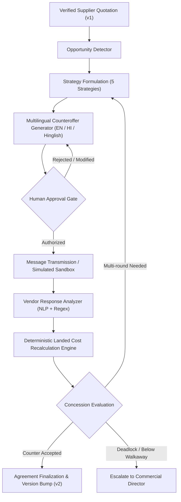

# IndusPilot Autonomous AI Supplier Negotiation Engine

## 1. Executive Summary & Objective

The IndusPilot Autonomous AI Supplier Negotiation Engine connects mathematical procurement optimization with real-world commercial execution. It equips manufacturing procurement teams with an agentic negotiation co-pilot that:
1. Detects commercial negotiation opportunities from verified supplier quotations.
2. Selects evidence-backed commercial strategies (Volume Commitment, Benchmark Parity, Payment Acceleration, Long-term Contract, Spot Clearance).
3. Drafts culturally tailored counteroffer messages in English, Hindi, and Hinglish.
4. Enforces strict human-in-the-loop governance (no counteroffer is transmitted without explicit authorized review).
5. Deterministically evaluates vendor counter-proposals across all 9 components of industrial landed cost without LLM math.
6. Simulates realistic, reproducible vendor concession curves for negotiation strategy stress-testing.
7. Automatically revisions agreed quotations into new official versions (`v2`) with immutable audit trails.

---

## 2. Agentic Negotiation Architecture

### Core Architecture Principles:
- **Zero LLM Math:** All calculations (landed cost changes, concession percentages, target spreads, gross margins) are performed strictly in Python `Decimal` (`ROUND_HALF_UP`). The LLM is used solely for natural language parsing, phrasing formulation, and sentiment classification.
- **Immutable Original Data:** Initial supplier quotations are never overwritten or deleted. Finalizing an agreement creates a parent-linked child quotation revision (`version=2`, `replaces_quotation_id=orig.id`).
- **Audit Logging:** Every dialogue round, counter-proposal rate, transmission timestamp, approver username, and extracted term is persisted in relational database tables.

---

## 3. Commercial Negotiation Strategies

IndusPilot implements 5 industrial commercial strategies:

| Strategy Code | Name | Rationale & Commercial Lever | Best Suited Scenario |
| :--- | :--- | :--- | :--- |
| `VOLUME_COMMITMENT` | Volume Commitment | Leverages consolidated factory batch demand to unlock supplier tier discounts. | Shortage batch >= 500 kg or multi-product consolidated orders. |
| `BENCHMARK_PARITY` | Benchmark Parity | References regional market indices (e.g. Mandi/Metals Daily, prevailing ASTM/IS base rates). | Supplier quote is > 5% higher than regional median price. |
| `PAYMENT_ACCELERATION` | Payment Acceleration | Offers prompt 10–15 day payment terms instead of standard 45–60 day credit. | Working capital liquid buyers seeking 2–4% cash rebate. |
| `LONG_TERM_CONTRACT` | Long-Term Contract | Commits to multi-quarter recurring orders in exchange for locked unit pricing. | High-frequency BOM materials with steady monthly MRP demand. |
| `SPOT_CLEARANCE` | Spot Clearance | Proposes immediate dispatch and off-take for existing mill coil stocks. | Suppliers with surplus warehouse inventories and short lead times. |

---

## 4. Opportunity Identification Engine

The opportunity detector evaluates a quotation against multiple benchmarks:
1. **Quotation Base Price vs. Material Standard Base Price:**
   $$\text{Premium \%} = \frac{P_{\text{quoted}} - P_{\text{catalog}}}{P_{\text{catalog}}} \times 100$$
2. **Batch Volume Leverage:**
   If order quantity $\ge 2 \times \text{MOQ}$, significant volume concession leverage exists.
3. **Regional Spread:**
   Compares the quoted unit price to the lowest verified quotation for the same material grade within the current procurement cycle.
4. **Target Counteroffer Pricing:**
   The engine computes:
   - Aggressive Target: $P_{\text{opening}} \times (1 - \text{target\_discount\_pct})$ (typically 5–8% reduction).
   - Walk-away Ceiling: $P_{\text{opening}} \times 0.99$ (ensuring at least nominal concession before agreement).

---

## 5. Commercial Guardrails & Human Authorization

To protect enterprise manufacturing operations from rogue agent communications:
1. **Mandatory Approval State (`AWAITING_APPROVAL`):**
   When an agent generates a counteroffer message, it cannot transition to `SENT` or `MESSAGE_TRANSMITTED` without an authorized user invoking `/api/v1/negotiation/messages/{id}/approve`.
2. **Full Text Editability:**
   Procurement managers have full authority in the UI to modify draft sentences, tighten payment terms, or adjust target numbers prior to authorization.
3. **Director Escalation Threshold:**
   If a proposed concession violates quality ratings, extends lead time beyond project deadlines, or requires purchase commitments exceeding ₹500,000, the session is flagged as `ESCALATED_TO_HUMAN`.

