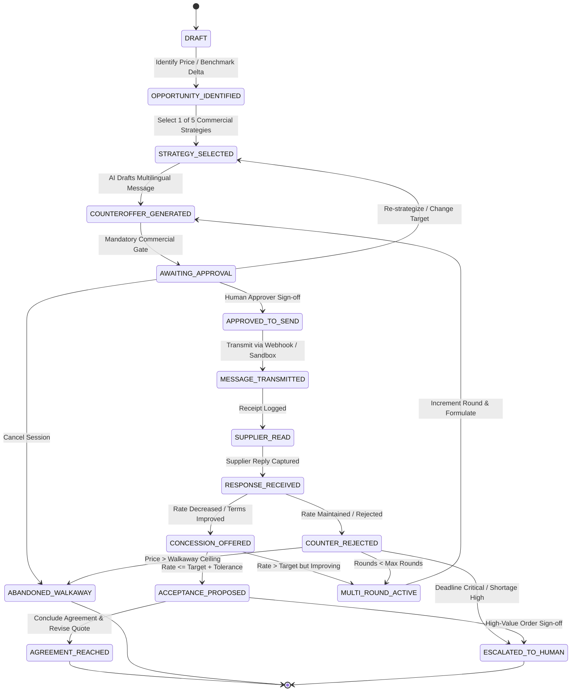

# IndusPilot Negotiation State Machine Specification

## 1. Overview

The IndusPilot Autonomous Supplier Negotiation Engine is governed by a rigorous 16-state deterministic finite state machine (FSM). This structure guarantees full audit compliance, prevents illegal skips, ensures human commercial oversight, and handles deadlocks, concessions, and formal agreement concluding.

---

## 2. State Definitions

The 16 states are defined in `NegotiationState`:

| # | State Enum Value | Category | Description |
|---|---|---|---|
| 1 | `DRAFT` | Initiation | Session created; initial baseline parameters recorded. |
| 2 | `OPPORTUNITY_IDENTIFIED` | Initiation | Potential landed savings or pricing benchmark spread verified. |
| 3 | `STRATEGY_SELECTED` | Preparation | Negotiation lever formulated (`VOLUME_COMMITMENT`, `BENCHMARK_PARITY`, etc.). |
| 4 | `COUNTEROFFER_GENERATED` | Drafting | Agent has drafted formal counteroffer text in chosen language. |
| 5 | `AWAITING_APPROVAL` | Governance | Mandatory human gate; message draft queued for buyer sign-off. |
| 6 | `APPROVED_TO_SEND` | Governance | Human buyer authorized message transmission without alteration or with edits. |
| 7 | `MESSAGE_TRANSMITTED` | Transmission | Communication dispatched via API, simulated channel, or email integration. |
| 8 | `SUPPLIER_READ` | Telemetry | Supplier acknowledged receipt or opened electronic counteroffer. |
| 9 | `RESPONSE_RECEIVED` | Feedback | Inbound response captured and ready for term extraction. |
| 10 | `CONCESSION_OFFERED` | Evaluation | Supplier decreased unit price, waived freight, or accelerated terms. |
| 11 | `COUNTER_REJECTED` | Evaluation | Supplier refused proposed target price and held firm or counter-offered high. |
| 12 | `MULTI_ROUND_ACTIVE` | Iteration | Additional negotiation round required (up to round ceiling). |
| 13 | `ACCEPTANCE_PROPOSED` | Decision | Favorable terms arrived within target band; buyer agent recommends closing. |
| 14 | `AGREEMENT_REACHED` | Terminal | Formal contract terms concluded; creates quotation revision `v2`. |
| 15 | `ESCALATED_TO_HUMAN` | Terminal / Exception | Impasse reached or deviation exceeds policy limits; manual override required. |
| 16 | `ABANDONED_WALKAWAY` | Terminal | Supplier firm at unviable price exceeding walk-away ceiling; session closed. |

---

## 3. Transition Rules & Sequence Diagram

---

## 4. State Validation Enforcement

The Python state transition controller validates every status mutation:
- Any jump directly from `COUNTEROFFER_GENERATED` to `MESSAGE_TRANSMITTED` without passing `AWAITING_APPROVAL` and `APPROVED_TO_SEND` raises an `InvalidStateTransitionError`.
- Transitioning to `AGREEMENT_REACHED` requires `current_offered_price <= max_walkaway_price`.
- Terminal states (`AGREEMENT_REACHED`, `ABANDONED_WALKAWAY`, `ESCALATED_TO_HUMAN`) cannot transition back to active rounds without an administrative re-opening action.

