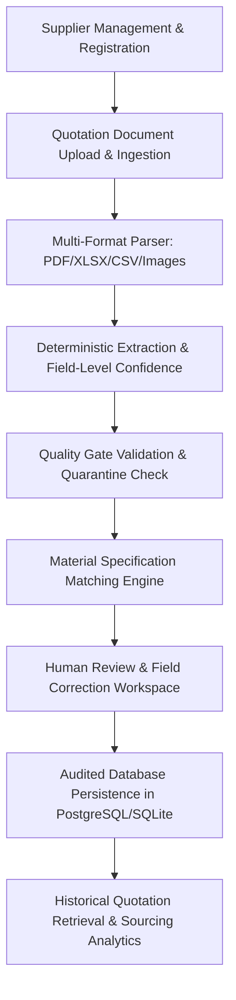

# IndusPilot — Phase 3 Implementation Plan
## Supplier Intelligence, Document Processing & Automated Quotation Extraction

**Hackathon Theme:** Industrial Manufacturing  
**Challenge / Problem Statement 4.1:** Raw Material Procurement and Manufacturing Quotation Optimisation  
**Author:** IndusPilot Software Architecture Team  
**Date:** March 2026  

---

## 1. Audit of Existing Codebase

### 1.1 Existing Models (`backend/app/models/entities.py`)
- `Supplier`: Holds name, contact_person, email, phone, address, city, state, gst_number, quality_rating, reliability_score, on_time_delivery_pct, payment_terms_days, is_simulated.
  - *Gaps to resolve:* Needs `company_name`, `country`, `postal_code`, `website`, `category`, `manufacturing_specialisation`, `credit_period_days`, `moq_general`, `capacity_monthly_tons`, `lead_time_days`, `total_historical_spend`, `total_orders_count`, `rejection_rate_pct`, `is_active`.
- `Material`: Holds code, name, category, grade, unit, density_g_cm3, standard_cost, description.
  - *Gaps to resolve:* Needs specification standards (e.g., ASTM A240, DIN 17440), manufacturing forms (Sheet, Plate, Coil, Bar, Fastener), and active status.
- `UploadedDocument`: Holds filename, file_path, file_type, file_size, status, confidence_score, raw_text.
  - *Gaps to resolve:* Needs `supplier_id`, processing workflow states (`UPLOADED`, `QUEUED`, `PROCESSING`, `EXTRACTED`, `NEEDS_REVIEW`, `VERIFIED`, `FAILED`), validation status, error messages, and raw extraction snapshot JSON.
- `SupplierQuotation` & `QuotationItem`: Holds quotation numbers, landed cost breakdowns, tax details, item descriptions, and quarantine flags.
  - *Gaps to resolve:* Need explicit separation between original machine-extracted data, user-corrected fields, and final verified records. Need foreign key to matched catalogue material with confidence scoring.

### 1.2 Existing Services & Calculation Engines
- `document_parser.py`: Basic PyMuPDF, pdfplumber, openpyxl, and CSV regex extraction.
  - *Gaps to resolve:* Needs a comprehensive, resilient multi-format pipeline with field-level confidence, source coordinate/page tracking, robust tabular extraction for complex formats, and a formal Quality Gate module.
- `scoring.py`, `landed_cost.py`, `procurement_optimizer.py`: Work cleanly with structured quotes.
  - *Extension:* Ready to consume the expanded verified quote records directly.

### 1.3 Existing Frontend Views
- `SuppliersView.tsx`: Read-only grid displaying suppliers and simulated ratings.
  - *Gaps to resolve:* Needs "Register Supplier" modal with comprehensive validation, supplier profile drawer/modal showing quotation history and materials supplied, editing capabilities, active/inactive toggles, and multi-criteria filtering.
- `QuotationUploadView.tsx`: Basic drag-and-drop file upload with preview of a single extraction.
  - *Gaps to resolve:* Needs full document ledger, multi-file support, side-by-side human review workspace, catalogue material matching selector, field correction inputs, quality gate warning resolution, and historical quotation archive ledger.

---

## 2. Step-by-Step Implementation Roadmap

### Phase 2: Complete Supplier Management System
1. Update `Supplier` model with all business, contact, and performance fields.
2. Implement supplier deduplication check (prevent duplicate GSTIN or exact name).
3. Build API endpoints: `POST /api/v1/suppliers`, `GET /api/v1/suppliers`, `GET /api/v1/suppliers/{id}`, `PATCH /api/v1/suppliers/{id}`, `DELETE /api/v1/suppliers/{id}` (safe soft-deactivation), `GET /api/v1/suppliers/{id}/quotations`.
4. Build `frontend/src/components/views/SuppliersView.tsx` with Create Modal, Edit Modal, Search, Filter by Category/City/Material, and Performance Details.

### Phase 3: Material Catalogue & Specification Matcher
1. Update `Material` model with standard industrial specifications and manufacturing forms.
2. Build `backend/app/services/material_matcher.py` with:
   - Grade and specification normalizer (e.g. "SS 304 sheet, 2mm" $\to$ "Stainless Steel 304 Sheet - 2.0mm").
   - Token-based alias resolution (AISI 304, SS304, 1.4301).
   - Form and thickness extraction.
   - Confidence scoring and candidate ranking.
   - Safe human-fallback when match is ambiguous.
3. Add `POST /api/v1/materials/match` endpoint.

### Phase 4: Document Upload & Storage System
1. Build `backend/app/api/v1/documents.py`:
   - Validates MIME type, extension, size limit (15MB), safe sanitized filenames, prevents path traversal.
   - Stores documents in `data/uploads/` securely.
   - Manages document lifecycle: `UPLOADED` $\to$ `PROCESSING` $\to$ `EXTRACTED` $\to$ `NEEDS_REVIEW` $\to$ `VERIFIED`.

### Phase 5: Intelligent Document Extraction Pipeline
1. Upgrade `backend/app/services/document_parser.py`:
   - PyMuPDF text & geometry extraction.
   - pdfplumber tabular grid recognition.
   - openpyxl spreadsheet reader.
   - CSV row parser.
   - Image OCR fallback (tesseract/PIL).
   - Structured Pydantic schema with field-level confidence and source page metadata.
   - Zero-key deterministic fallback guarantees reliability without paid API keys.

### Phase 6: Extraction Quality Gate
1. Implement `backend/app/services/quality_gate.py`:
   - Classifies documents into: `READY_FOR_REVIEW`, `NEEDS_CORRECTION`, `QUARANTINED`.
   - Checks: missing quotation number, missing supplier, missing currency, negative/zero prices, unverified units, tax ambiguity, total arithmetic discrepancies.

### Phase 7: Human Review & Correction Interface
1. Enhance `QuotationUploadView.tsx`:
   - Document upload dropzone with real-time status tracker.
   - Document queue table with quality status badges.
   - Interactive modal workspace:
     - Original document metadata & raw text snippet.
     - Editable supplier header fields (supplier, quote number, dates, tax inclusive/exclusive toggle, freight).
     - Editable line item table with material catalogue match selector.
     - Confidence pill indicators and quarantine warning alerts.
     - Final "Confirm & Verify" action persisting the audited record.

### Phase 8: Quotation Database & Historical Search
1. Persist clean separation: `original_extracted_data` vs `user_corrected_data` vs `final_verified_record`.
2. Provide quotation history archive with search by quote number, filter by supplier, filter by material, and date range.

### Phase 9: Demonstration Data & Verification
1. Expand synthetic seed data to 10 suppliers, 20 materials, and 30+ structured quotation records.
2. Provide sample files (PDF, XLSX, CSV, image) in `data/sample_quotations/`.
3. Comprehensive test suite in `backend/tests/test_phase3_suppliers_and_extraction.py`.
4. Production build verification: `npm run build`.

