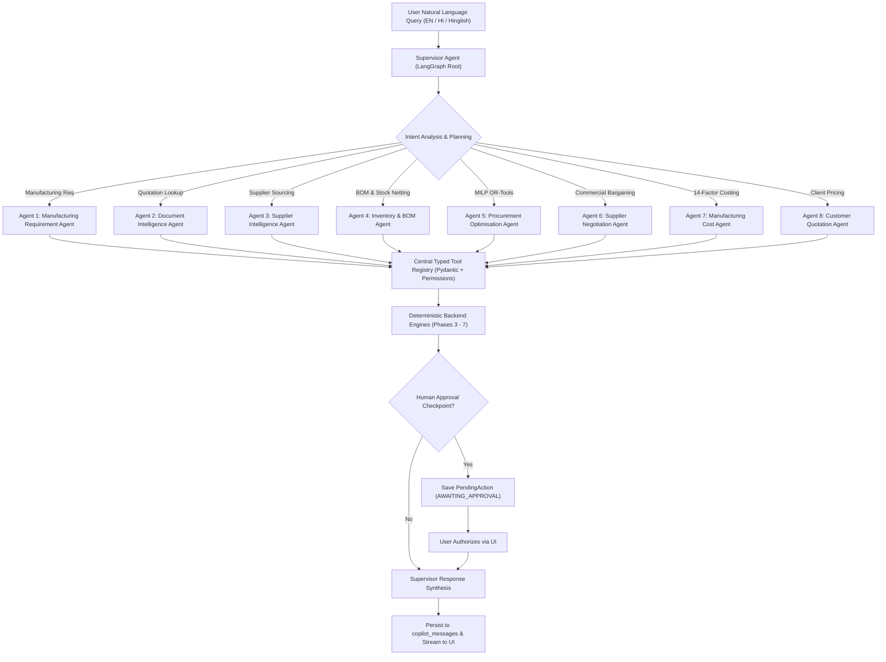

# IndusPilot Phase 8 — Implementation Plan & AI Architecture Audit
## Intelligent Manufacturing Copilot, Multi-Agent Orchestration & Autonomous Workflow Supervisor

**Project:** IndusPilot (Tech4Bharat 2026 — Theme: Industrial Manufacturing, Problem 4.1)  
**Author:** IndusPilot Engineering Team (`CodeBloodMe`)  
**Phase:** 8 — Intelligent Copilot & Multi-Agent LangGraph Supervisor  

---

## Part 1: Comprehensive Audit of Existing AI & Orchestration Implementation

Before initiating Phase 8 implementation, a complete code and runtime audit was conducted across `backend/app/agents/orchestrator.py`, `backend/app/api/v1/copilot.py`, `frontend/src/components/views/CopilotView.tsx`, and existing database models.

### Detailed Audit Responses (Mandatory 8 Evaluation Criteria):

| # | Audit Criterion | Audit Finding & Gap Identified | Phase 8 Engineering Solution |
| :--- | :--- | :--- | :--- |
| **1** | **Is LangGraph actually implemented?** | **NO.** The existing `IndusPilotAgentOrchestrator` was a monolithic single-class regex matcher. `langgraph` package was not installed in `backend/.venv`. | Installed `langgraph` (v1.2.19) and `langchain-core` (v1.7.4). Implementing a typed `StateGraph` with a Supervisor Node, 8 specialized agent nodes, conditional edge routing, and checkpointing. |
| **2** | **Is LLM tool calling working?** | **NO.** Zero tool calling existed. Keyword regexes invoked hardcoded branches directly with fixed arguments. | Implementing a typed Tool Registry (`ToolRegistry`) with Pydantic schemas (`BaseModel`), input validation, and LLM tool calling (supporting Gemini, OpenAI, and zero-key DEMO mode). |
| **3** | **Do tools use real backend services?** | **PARTIALLY.** While mathematical functions (`calculate_landed_cost`, `explode_bom`, etc.) were imported, the orchestrator passed mock candidate lists (e.g. `sup-apex`, `sup-bharat`) rather than querying live database tables. | Every tool will execute against real SQLAlchemy session records (`Product`, `BOM`, `InventoryLedger`, `SupplierQuotation`, `ProcurementPlan`, `CustomerQuotation`, `CostEstimate`). |
| **4** | **Is conversation history persisted?** | **NO.** The existing `/api/v1/copilot/chat` endpoint was completely stateless. Conversations and messages vanished upon completion. | Adding relational database tables: `copilot_conversations`, `copilot_messages`, `agent_runs`, `agent_run_steps`, `agent_tool_calls`, `workflow_checkpoints`, and `pending_agent_actions`. |
| **5** | **Are organisation-level permissions enforced?** | **NO.** `org_id` was received via dependency injection but discarded in `orchestrator.py`. | Strict multi-tenant isolation enforced on every conversation, message, tool execution, and database lookup (`organization_id = org_id`). |
| **6** | **Are approval checkpoints implemented?** | **NO.** The orchestrator only returned a static JSON boolean flag `requires_human_approval: True` with no backend pausing, persistence, or resumption mechanism. | Workflow state machine halts at `AWAITING_APPROVAL`, saves a `PendingAgentAction`, and exposes `/copilot/actions/{id}/approve` and `/copilot/actions/{id}/reject` to resume the LangGraph workflow. |
| **7** | **Can agent execution recover after failure?** | **NO.** Any runtime exception crashed the API request with a 500 error. No retry budget or checkpoint resumption existed. | LangGraph checkpoint persistence records intermediate node states; errors transition to `FAILED` with event logs and allow `/copilot/runs/{id}/resume`. |
| **8** | **Are simulated and real operations distinguishable?** | **NO.** Simulated quotes and real quotations were blended together in responses. | Clear audit segregation: simulated operations carry `is_simulated = True` and explicit `[SIMULATED]` badges in text and data outputs. |

---

## Part 2: Product Vision — One Conversational Manufacturing Supervisor

A factory owner or plant manager should not need to navigate 10 distinct modules to fulfill an order. Through natural language in English, Hindi, or Hinglish, IndusPilot coordinates the entire lifecycle:



---

## Part 3: LangGraph State & Multi-Agent Architecture

### State Definition: `CopilotWorkflowState`
```python
from typing import TypedDict, List, Dict, Any, Optional

class CopilotWorkflowState(TypedDict):
    conversation_id: str
    run_id: str
    org_id: str
    user_id: Optional[str]
    messages: List[Dict[str, Any]]
    current_intent: str
    selected_agents: List[str]
    active_agent: str
    context_data: Dict[str, Any]
    tool_calls: List[Dict[str, Any]]
    workflow_status: str # STARTED, PLANNING, EXECUTING, AWAITING_APPROVAL, COMPLETED, FAILED
    requires_approval: bool
    pending_action_id: Optional[str]
    error_message: Optional[str]
    final_response: Optional[str]
```

### The 9 Coordinated Agents:
1. **Manufacturing Requirement Agent:** Parses user prompt into structured product code, batch quantity, engineering grade, scrap tolerance, and target timeline.
2. **Document Intelligence Agent:** Retrieves verified supplier quotations and parsed item specifications.
3. **Supplier Intelligence Agent:** Queries supplier directory, checks eligibility, and runs multi-factor scoring.
4. **Inventory & BOM Agent:** Explodes active BOM revision for requested batch size, checks physical stock vs reserved stock, and calculates net material shortage.
5. **Procurement Optimisation Agent:** Constructs solver input, executes Google OR-Tools MILP optimizer, validates solver status, and extracts multi-supplier quota split.
6. **Supplier Negotiation Agent:** Formulates evidence-backed counteroffers (5 strategies), simulates concessions, and recalculates 9-component landed costs.
7. **Manufacturing Cost Agent:** Executes 14-factor manufacturing cost engine (raw materials, direct labor, machine rates, electricity, packaging, overheads).
8. **Customer Quotation Agent:** Evaluates gross margin % vs markup %, checks loss-making contract guard, drafts customer quotation, and triggers PDF rendering.
9. **Supervisor Agent:** Root router. Analyzes conversation history, generates multi-step execution plan, invokes minimal required agents, handles failures, and prepares final explainable business synthesis.

---

## Part 4: Tool Permission & Governance Hierarchy

Every tool in the central registry is classified into one of 4 strict permission tiers:

| Tier | Classification | Execution Policy | Example Tools |
| :--- | :--- | :--- | :--- |
| **Tier A** | `READ_ONLY` | Auto-executable for authenticated users | `search_suppliers`, `get_bom`, `check_inventory`, `calculate_material_shortages`, `retrieve_cost_estimate` |
| **Tier B** | `DRAFT_CREATION` | Auto-creates reversible draft records | `create_procurement_plan`, `create_customer_quotation_draft`, `generate_negotiation_message`, `simulate_cost_scenario` |
| **Tier C** | `SENSITIVE_MUTATION` | Halts workflow; requires human confirmation | `reserve_inventory`, `approve_customer_quotation`, `recalculate_customer_quotation`, `finalize_negotiation_agreement` |
| **Tier D** | `EXTERNAL_ACTION` | Strict human authorization; never auto-executed | `transmit_negotiation_message`, `dispatch_purchase_order`, `send_customer_quotation` |

---

## Part 5: Relational Schema & Database Extensions

Adding tables to SQLite/PostgreSQL schema:
- `copilot_conversations`: Tracks conversation threads, titles, user ownership, and organization multi-tenancy.
- `copilot_messages`: Chronological conversation turns, roles (`user`, `assistant`, `tool`), tool calls, and structured card data.
- `agent_runs`: Tracks complete workflow lifecycles (`run_id`, `objective`, `status`, `timing`).
- `agent_run_steps`: Step-by-step trace of agent routing and intent classification.
- `agent_tool_calls`: Audit record of exact tool arguments, outputs, execution duration, and permission classifications.
- `pending_agent_actions`: Paused commercial actions awaiting explicit human authorization.
- `workflow_checkpoints`: Serialized LangGraph state checkpoints allowing resuming across user sessions.

---

## Part 6: Step-by-Step Implementation Roadmap

1. **Step 1:** Define database models and Alembic migration `0007_copilot_and_multiagent_orchestration.py`.
2. **Step 2:** Build the Central Typed Tool Registry (`backend/app/agents/tools/registry.py`) with Pydantic schemas and permission gates.
3. **Step 3:** Implement Provider-Agnostic LLM Engine (`backend/app/agents/llm_provider.py`) supporting Gemini, OpenAI, and deterministic DEMO mode.
4. **Step 4:** Build the 8 Specialized Agents and LangGraph StateGraph Supervisor (`backend/app/agents/langgraph_supervisor.py`).
5. **Step 5:** Implement Persistent Conversation Service (`backend/app/services/copilot_service.py`).
6. **Step 6:** Implement REST API Endpoints under `/api/v1/copilot/...`.
7. **Step 7:** Upgrade Frontend Copilot View (`frontend/src/components/views/CopilotView.tsx`) with conversation sidebar, rich structured business response cards, and live Agent Activity Panel.
8. **Step 8:** Build deterministic 20-scenario evaluation suite (`docs/COPILOT_EVALUATION.md`) and automated test suite (`backend/tests/test_phase8_copilot_orchestration.py`).
9. **Step 9:** Execute verification (100% tests pass, `npm run build` succeeds, all documentation created).

