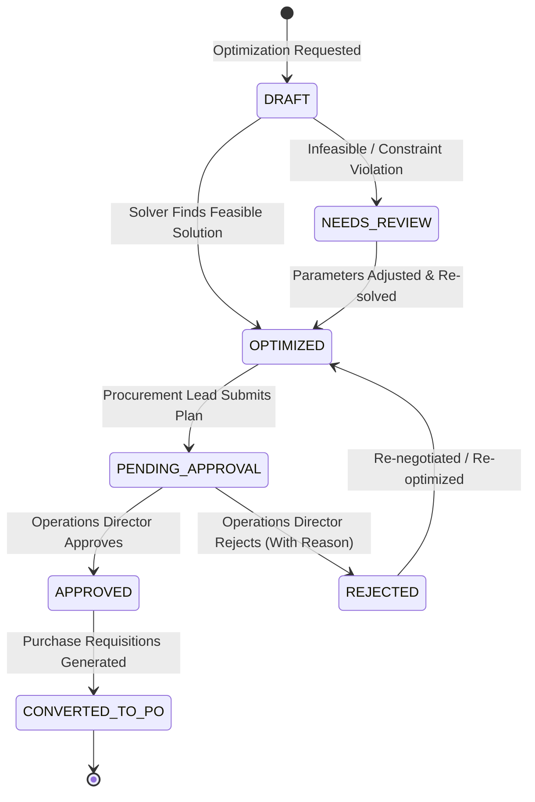

# IndusPilot — Procurement Governance & Managerial Approval Workflow

## 1. Governance Architecture

In manufacturing operations, allocating procurement capital requires formal managerial authorization to prevent unauthorized spending, maintain audit trails, and ensure compliance with internal financial controls.

IndusPilot implements a multi-tier approval workflow that sits directly between mathematical optimization and purchase requisition dispatch:

---

## 2. State Definitions & Transitions

| Plan Status | Description | Allowed Actions |
| :--- | :--- | :--- |
| **`DRAFT`** | Initial requirement defined; optimization running. | Cancel |
| **`OPTIMIZED`** | Solver found optimal Pareto allocation meeting all constraints. | Re-optimize, Request Approval |
| **`NEEDS_REVIEW`** | Infeasible due to capacity, budget, MOQ, or lead time conflicts. | Adjust Constraints, Re-solve |
| **`PENDING_APPROVAL`** | Submitted to operations/finance leadership for review. | Approve, Reject |
| **`APPROVED`** | Formally authorized by management; ready for procurement. | Generate Purchase Requisitions |
| **`REJECTED`** | Rejected by leadership with documented audit rationale. | View Rationale, Re-optimize |
| **`CONVERTED_TO_PO`** | Formal Purchase Requisitions generated in ERP ledger. | View Requisitions, Export PO |

---

## 3. Managerial Roles & Access Controls

- **Procurement Officer / Lead**:
  - Sets up optimization requirements (either from MRP shortages or manual demand).
  - Configures optimization strategies and constraints.
  - Reviews mathematical solver outputs and baseline savings.
  - Submits finalized plans for managerial review (`POST /plans/{id}/request-approval`).

- **Operations Director / Plant Head**:
  - Reviews total landed expenditures, supplier splits, and budget utilization.
  - Evaluates baseline savings against industry standard purchasing habits.
  - Authorizes procurement plan (`POST /plans/{id}/approve`).
  - Or rejects plan with a mandatory text rationale (`POST /plans/{id}/reject`).

---

## 4. Automatic Purchase Requisition Generation

Once a procurement plan is in the `APPROVED` state, clicking **Dispatch Purchase Requisitions** triggers `generate_purchase_requisitions_from_plan`:

1. **Atomic Grouping by Supplier**:
   All allocations in the plan are grouped by `supplier_id`.
2. **Requisition Ledger Creation**:
   For each distinct supplier, a new `PurchaseRequisition` record is created in the database:
   - `requisition_number`: Generated sequentially (`REQ-2026-XXXX`).
   - `material_id`: Specific raw material.
   - `supplier_id`: Awarded vendor.
   - `quantity`: Mathematically optimized allocation.
   - `estimated_cost`: Unit landed price $\times$ quantity.
   - `required_by_date`: Delivery deadline.
   - `status`: Marked as `PENDING` ready for PO conversion.
   - `notes`: Formally cross-references `ProcurementPlan.plan_number`.
3. **Audit Trail Preservation**:
   The plan status transitions to `CONVERTED_TO_PO`, locking the plan from further re-optimization and establishing a full tamper-evident audit trail.

