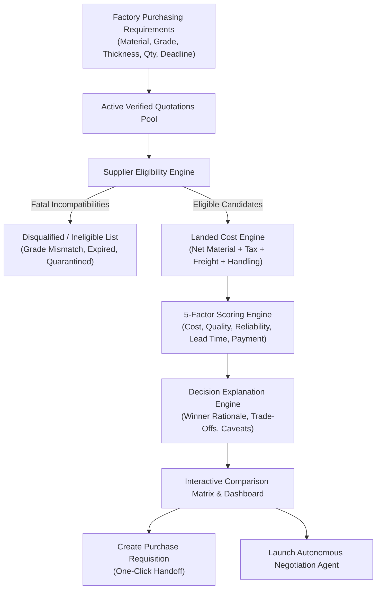

# IndusPilot Procurement Comparison & Decision Engine

## 1. Executive Summary

The **IndusPilot Procurement Decision Engine** transforms raw, unstructured supplier quotations into objective, explainable, and operationally viable purchasing decisions for small and medium manufacturing enterprises (SMEs).

Rather than relying on naive lowest-price selection or opaque "black-box" AI recommendations, IndusPilot combines:
1. **Multi-Constraint Eligibility Screening** to filter out technically or commercially incompatible bids.
2. **Deterministic Total Landed Cost Computation** with strict GST and freight transparency.
3. **5-Factor Explainable Scoring** with dynamic weight renormalization and low-evidence flags.
4. **Natural Language Decision Synthesis** that produces human-auditable trade-off explanations.
5. **Seamless Procurement Requisition Handoff** linking directly to purchase orders and ERP records.

---

## 2. End-to-End Decision Workflow

---

## 3. The Supplier Eligibility Engine (`eligibility_engine.py`)

Before scoring suppliers, the system screens all candidate quotations against 6 operational constraints:

### 3.1 Material & Grade Compatibility
- Strict metallurgical grade canonicalization (e.g. `SS304` vs `SS316` are non-interchangeable).
- Form factor matching (e.g. `SHEET`, `PLATE`, `COIL`, `BAR`).
- Dimensional tolerance checks (e.g. thickness in mm within allowable manufacturing tolerance \(\pm 0.1 \text{ mm}\)).

### 3.2 Quantity & Minimum Order Quantity (MOQ)
- Rejection or conditional flagging if required volume is below supplier's MOQ.
- Tiered price breaks automatically mapped to target batch size.

### 3.3 Delivery Deadline & Lead Time
- Rejection if quoted delivery date exceeds the factory's absolute required deadline date.
- Flagging if lead time is tight relative to factory production schedules.

### 3.4 Commercial & Quotation Validity
- Automatic disqualification if quotation has expired (`valid_until < current_date`).
- Flagging if quote expires in less than 48 hours.

### 3.5 Vendor Standing & Quarantine Status
- Immediate rejection if the supplier has been placed under quality quarantine or blacklist due to unresolved disputes, counterfeit certifications, or repeated NCRs (Non-Conformance Reports).

### Eligibility Status Classification:
- `ELIGIBLE`: Passes all constraints without warnings.
- `CONDITIONALLY_ELIGIBLE`: Minor non-fatal variance (e.g., thickness differs within allowable tolerance, or quote expires in 3 days).
- `INELIGIBLE`: Fatal failure (e.g., wrong material grade, quotation expired, or supplier quarantined).
- `NEEDS_REVIEW`: Missing critical parameters such as unstated tax status.

---

## 4. Total Landed Cost Architecture

The landed cost engine guarantees full economic parity across disparate quotation formats:
- Resolves ex-factory vs delivered pricing.
- Corrects for GST inclusion or exclusion without double-counting.
- Allocates bulk freight across multi-item bills of materials (BOMs).
- Factors in commercial payment terms working capital financing cost.

---

## 5. Decision Explanation Engine (`decision_explainer.py`)

To eliminate "black-box" skepticism from factory procurement managers, every recommendation is paired with an audit explanation:
- **Primary Recommendation:** Explains why Candidate #1 earned the top rank.
- **Key Differentiator:** Highlights specific advantages (e.g., ₹12.50/kg lower freight, 4-day faster delivery, or 60-day credit).
- **Comparative Trade-Off:** Explains why Candidate #2 was not chosen (e.g., "Janata Inox is ₹3.20 cheaper on face price, but after adding ₹14.50/kg freight from Rajkot, Titan Alloy delivers a ₹8.30 lower net landed cost").
- **Operational Caveats:** Highlights constraints such as quotation expiration dates or MTC verification requirements.

---

## 6. Downstream Workflow Handoffs

Once a comparison is finalized:
1. **Purchase Requisition Handoff (`POST /api/v1/procurement/requisitions`):** Generates an audit-linked internal requisition record with locked unit prices, quantities, and selected supplier ID.
2. **Autonomous Negotiation (`POST /api/v1/negotiation/start`):** Supplies benchmark target prices and volume discount goals to the multi-turn negotiation agent.
3. **Executive Approval Matrix (`/approvals`):** Requisitions exceeding ₹1,00,000 are routed to the manufacturing plant manager for digital sign-off.

