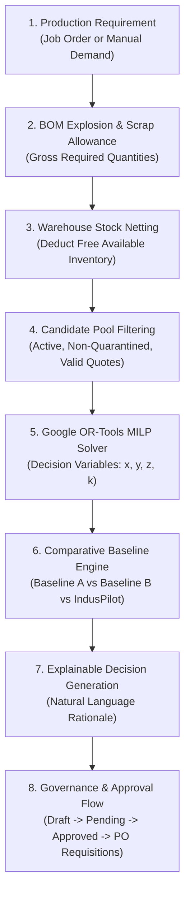

# IndusPilot — Advanced Procurement Planning & Mathematical Optimisation Engine

## 1. Executive Summary

The **IndusPilot Advanced Procurement Optimisation Engine** connects raw material cataloguing, automated quotation extraction, 5-factor supplier scoring, BOM explosion, and inventory netting into a unified, mathematically rigorous procurement decision system.

Built specifically for the **Tech4Bharat 2026 Hackathon (Industrial Manufacturing Theme — Problem Statement 4.1)**, IndusPilot solves a mission-critical dilemma for Indian small and medium enterprises (MSMEs):

> *"Which suppliers should the factory purchase raw materials from, in what exact quantities, across what delivery timeline, to achieve the lowest true landed cost while strictly respecting vendor MOQs, monthly capacities, packaging lot sizes, quality standards, and budget limits?"*

IndusPilot replaces informal spreadsheet heuristics and subjective vendor selection with **Google OR-Tools Mixed-Integer Linear Programming (MILP)** powered by the SCIP solver. Every allocation is Pareto-optimal, deterministically auditable, and backed by automated baseline savings benchmarks and managerial approval governance.

---

## 2. End-to-End Procurement Workflow

### Workflow Steps:
1. **Demand Ingestion**: Requirements originate either automatically from an active production job (exploding the Bill of Materials and subtracting warehouse stock) or manually from custom multi-material procurement requisitions.
2. **Eligibility Filtering**: Vendor quotations undergo strict compliance checks (excluding quarantined, expired, or non-compliant quotes).
3. **Mathematical Optimisation**: Formulates continuous purchase quantities ($x_{s,m}$), supplier selection binaries ($y_{s,m}$), order activation binaries ($z_s$), and packaging integer variables ($k_{s,m}$).
4. **Baseline Benchmarking**: Measures exact rupee savings against common industry defaults (Single Sourcing and Fragmented Cheapest Sourcing).
5. **Governance & Approval**: Enforces multi-tier managerial review before committing factory capital.
6. **ERP Requisition Handoff**: Converts approved plans into immutable Purchase Requisitions ready for purchase order dispatch.

---

## 3. Core Architectural Modules

| Module File | Responsibility |
| :--- | :--- |
| `backend/app/optimizers/multi_material_optimizer.py` | Google OR-Tools MILP formulation, 5 objective strategies, constraint builders, solver execution, and infeasibility diagnostics. |
| `backend/app/services/procurement_baseline.py` | Calculates Baseline A (Single Vendor), Baseline B (Cheapest Quoted per Material), Baseline C (IndusPilot MILP), and delta savings. |
| `backend/app/services/procurement_plan_service.py` | Candidate pool filtering, plan creation, re-optimization, approval workflows, and purchase requisition generation. |
| `backend/app/models/entities.py` | SQLAlchemy models for `ProcurementPlan`, `ProcurementPlanItem`, and `ProcurementPlanAllocation`. |
| `backend/app/api/v1/procurement.py` | RESTful API endpoints for strategy querying, plan creation, re-optimization, and approval state transitions. |
| `frontend/src/components/views/OptimizationView.tsx` | Interactive React console for parameter tuning, baseline visualization, supplier quota breakdown, and approval dispatch. |

---

## 4. Key Procurement Strategies

IndusPilot supports five distinct optimization strategies tailored to dynamic factory priorities:

1. **`LOWEST_LANDED_COST`** *(Default)*:
   Minimises the exact total landed procurement expenditure:
   $$\min \sum_{s,m} \text{LandedCost}_{s,m} \cdot x_{s,m} + \sum_s \text{FixedFreight}_s \cdot z_s$$
2. **`BALANCED`** *(Multi-Criteria Compromise)*:
   Pareto-optimal trade-off between price (40%), quality rating (25%), delivery reliability (25%), and expedited lead times (10%).
3. **`FASTEST_DELIVERY`**:
   Minimises overall production downtime by penalising long delivery lead times.
4. **`QUALITY_FIRST`**:
   Allocates orders to suppliers with certified ISO/AS9100 quality compliance, high audit ratings, and near-zero historical scrap rates.
5. **`BUDGET_CONSTRAINED`**:
   Ensures that total expenditures strictly adhere to an upper financial ceiling while fulfilling 100% of material requirements.

---

## 5. Industrial Compliance & Precision

- **Deterministic Financial Calculations**: All landed cost conversions and baseline deltas utilize standard financial rounding (`ROUND_HALF_UP`) with zero floating-point drift.
- **Physical Feasibility**: Supplier capacities are bounded by real monthly production capacity figures (`capacity_monthly_units`).
- **Minimum Order Quantities (MOQ)**: Vendor-enforced lot size requirements are modeled using semi-continuous binary activation ($x_{s,m} \ge \text{MOQ}_{s,m} \cdot y_{s,m}$).
- **Packaging Integrity**: Discrete items (e.g. fasteners, bolts, cartons) are constrained to integer box multiples ($x_{s,m} = \text{PackageSize}_{s,m} \cdot k_{s,m}$).

