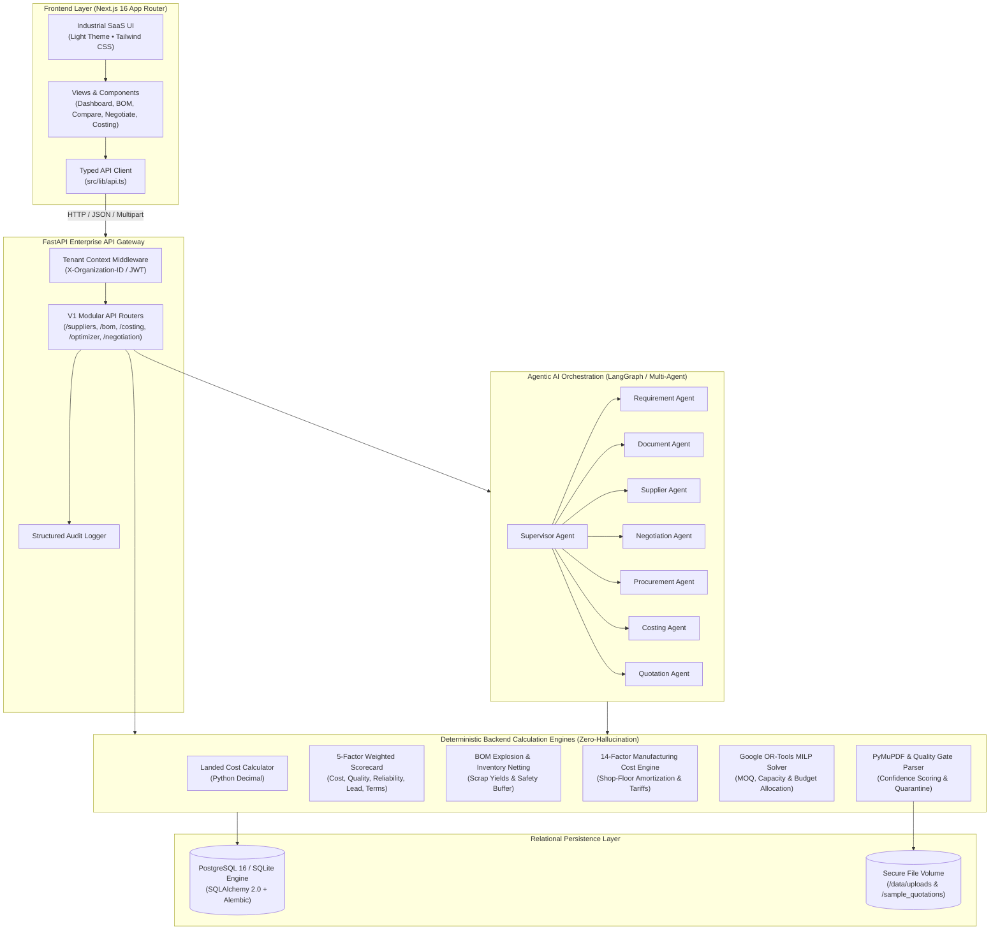

# IndusPilot — System Architecture Document

**System Name:** IndusPilot (Agentic AI for Intelligent Manufacturing Procurement & Quotation Optimisation)  
**Target Event:** Tech4Bharat 2026 Hackathon  
**Target Theme:** Industrial Manufacturing — Problem Statement 4.1  
**Document Version:** 1.1.0 (Comprehensive Engineering Blueprint)  

---

## 1. High-Level Architectural Diagram



---

## 2. Frontend Architecture (Next.js App Router)

- **Framework:** Next.js 16 (App Router) with Turbopack bundler.
- **Language:** TypeScript 5.0+ enforcing strict type-checking across API contracts and component props.
- **Styling & Design System:**
  - Tailwind CSS with an industrial light theme as default (`#f8fafc` off-white background, `#0f172a` graphite typography, `#2563eb` industrial blue, `#0d9488` teal accents).
  - High-readability tables, clean financial metrics cards, and responsive layouts.
- **Component Organization:**
  - `src/components/Header.tsx`: Factory credentials banner, live simulation mode pill, pending approvals counter, and demo re-seed trigger.
  - `src/components/Sidebar.tsx`: Industrial navigation menu categorizing Procurement Intelligence, Manufacturing & Costing, and Enterprise Governance.
  - `src/components/views/`: Isolated, modular views for each business domain (`DashboardView`, `QuotationUploadView`, `SupplierCompareView`, `NegotiationView`, `BOMManagerView`, `InventoryView`, `CostingEngineView`, `OptimizationView`, `CustomerQuotesView`, `CopilotView`, `ApprovalCentreView`, `SuppliersView`, `AnalyticsView`, `SettingsView`, `ScenarioView`).
- **API Client Layer:** `src/lib/api.ts` provides strongly typed async functions wrapping all REST endpoints, injecting tenant context headers, and providing structured error handling.
- **Form Validation & State Management:** React controlled forms with immediate validation on numeric ranges (e.g. quantity $> 0$, target margin $< 100\%$, selling price $\ge$ break-even price).

---

## 3. Backend Architecture (FastAPI & Modular Services)

- **Framework:** Python 3.12 + FastAPI with asynchronous route handlers and Starlette ASGI middleware.
- **Configuration Management:** `app/core/config.py` using `pydantic-settings` to manage environment variables (`DATABASE_URL`, `SECRET_KEY`, `SIMULATION_MODE`, `UPLOAD_DIR`) with automatic local `.env` loading.
- **Database Engine & ORM:**
  - SQLAlchemy 2.0 declarative models (`app/models/entities.py`).
  - Automatic dialect handling: connects to PostgreSQL 16 in production/docker; falls back to SQLite (`sqlite:///./induspilot.db`) for immediate zero-setup local execution.
  - Database schema migrations managed via Alembic (`backend/alembic/`).
- **Multi-Tenant Scoping:**
  - `app/api/deps.py` extracts the organization context (`X-Organization-ID`) from request headers.
  - Every SQLAlchemy query is scoped to `organization_id`, ensuring strict tenant isolation.
- **Structured Error Handling:** Standardized HTTP exceptions with informative detail payloads, preventing server crashes on bad inputs or low OCR confidence.

---

## 4. AI & Agentic Orchestration Architecture

- **Supervisor Agent Pattern:** Evaluates incoming user prompts (English, Hindi, or Hinglish), classifies intent, routes to the appropriate specialized sub-agent, and synthesizes tool outputs into structured, explainable responses.
- **The 9 Specialized Agents:**
  1. *Requirement Agent:* Converts natural-language customer requirements into structured BOM specifications.
  2. *Document Intelligence Agent:* Coordinates PyMuPDF extraction and evaluates the automated Quality Gate.
  3. *Supplier Intelligence Agent:* Runs landed cost models and computes the 5-factor weighted scorecard.
  4. *Procurement Planning Agent:* Explodes BOMs, checks warehouse stock, and calculates net purchasing shortages.
  5. *Negotiation Agent:* Formulates counteroffers, drafts localized commercial emails, and simulates vendor concession curves.
  6. *Cost Intelligence Agent:* Invokes the deterministic 14-factor manufacturing cost engine.
  7. *Optimization Agent:* Formulates and executes Google OR-Tools MILP optimization runs.
  8. *Customer Quotation Agent:* Generates client quotation proposals and verifies gross profit margins.
  9. *Supervisor Agent:* Orchestrates agent turns, maintains conversation context, and halts for human approvals.
- **Human Approval Checkpoints:** Any binding financial transaction (dispatching a counteroffer, placing a purchase order, or issuing a customer quote) enters a `PENDING_APPROVAL` status in the Approval Centre and requires explicit human operator sign-off before external execution.
- **Zero-Key Fallback Mode:** Operates deterministically without external LLM API dependencies; uses rule-based parsing, regexes, and template engines when API keys are absent.

---

## 5. Optimization & Mathematical Architecture

- **Engine:** Google OR-Tools (Mixed-Integer Linear Programming - SCIP / CBC solvers).
- **Objective:**
  $$\min \sum_{i=1}^N \Big( c_i \cdot x_i + f_i \cdot y_i \Big)$$
  where $x_i$ is quantity purchased from vendor $i$, $c_i$ is unit landed cost, $f_i$ is fixed shipping charge, and $y_i \in \{0, 1\}$ is the vendor activation variable.
- **Constraints:**
  1. Demand Satisfaction: $\sum_{i=1}^N x_i = \text{Required Quantity}$
  2. Minimum Order Quantity (MOQ): $x_i \ge \text{MOQ}_i \cdot y_i$
  3. Supplier Monthly Capacity: $x_i \le \text{Capacity}_i \cdot y_i$
  4. Total Budget Ceiling: $\sum_{i=1}^N \Big( c_i \cdot x_i + f_i \cdot y_i \Big) \le \text{Budget}$
  5. Delivery Deadline: $L_i \cdot y_i \le \text{Max Delivery Days}$
- **Explainability:** Explains why volumes were allocated or split, identifies the binding bottleneck constraints, and explains rejected alternatives.

---

## 6. Document Processing & Quality Gate Architecture

```
[Raw File: PDF / Scan / Excel / CSV]
                 |
                 v
   +-----------------------------+
   |  Format & Size Validation   |  (Max 15MB, MIME checking)
   +-----------------------------+
                 |
                 v
   +-----------------------------+
   |  PyMuPDF / pdfplumber       |  (Extract text & tabular matrix)
   +-----------------------------+
                 |
                 v
   +-----------------------------+
   |  Regex & Pattern Extraction |  (Unit price, freight, tax %, MOQ, lead time)
   +-----------------------------+
                 |
                 v
   +-----------------------------+
   |  Automated Quality Gate     |
   +-----------------------------+
        |                 |
  Confidence >= 0.85      Confidence < 0.85
  & Valid Fields          or Missing Price
        |                 |
        v                 v
   [VERIFIED]       [QUARANTINED]
        |                 |
        +--------+--------+
                 |
                 v
   +-----------------------------+
   |  Human Review & Save Modal  |
   +-----------------------------+
```

---

## 7. End-to-End Workflow Data Flow Diagram

```mermaid
sequenceDiagram
    autonumber
    actor Owner as Factory Owner
    participant UI as Next.js Web UI
    participant API as FastAPI Gateway
    participant BOM as BOM & Netting Engine
    participant Doc as Document Intelligence
    participant Opt as Google OR-Tools
    participant Neg as Negotiation Agent
    participant Cost as 14-Factor Cost Engine
    participant Quote as Customer Quotation Engine
    participant Approval as Approval Centre

    Owner->>UI: Input Order: 500 SS304 Industrial Brackets
    UI->>API: POST /api/v1/bom/explode (500 units)
    API->>BOM: Explode BOM (2.0 kg/unit + 5% scrap)
    BOM-->>API: Gross: 1,050 kg | Available: 200 kg | Net Shortage: 900 kg
    API-->>UI: Display Shortage Alert (Requisition: 900 kg)

    Owner->>UI: Upload Supplier Quotes (Apex, Bharat, Deccan PDFs)
    UI->>API: POST /api/v1/quotations/upload
    API->>Doc: Extract Rates, Freight, MOQs, Tax Terms
    Doc-->>API: Extracted Quotes & Quality Gate Status
    API-->>UI: Show Ingestion Review Modal (Verified)

    Owner->>UI: Run Supplier Comparison
    UI->>API: POST /api/v1/compare/evaluate
    API-->>UI: 5-Factor Scorecard (Apex Steel Ranked #1: 84.8/100)

    Owner->>UI: Launch Negotiation with Apex Steel (Target: ₹295/kg)
    UI->>API: POST /api/v1/negotiation/start
    API->>Neg: Generate Counteroffer Draft & Leverage
    Neg-->>API: Counteroffer in READY_FOR_APPROVAL status
    API->>Approval: Register Human Approval Request
    API-->>UI: Display Counteroffer for Owner Review

    Owner->>UI: Click "Authorize & Send Counteroffer"
    UI->>API: POST /api/v1/negotiation/send-and-simulate
    API->>Neg: Simulate Vendor Concession Curve
    Neg-->>API: Apex Steel Counter: Agrees to ₹305/kg (Saves ₹8,000)
    API-->>UI: Update Active Price (₹305/kg) & State to RESPONSE_RECEIVED

    Owner->>UI: Run OR-Tools Procurement Optimization
    UI->>API: POST /api/v1/optimizer/solve (Budget: ₹2.75L)
    API->>Opt: Solve Mixed-Integer Linear Program
    Opt-->>API: Optimal Purchase Allocation
    API-->>UI: Display Mathematical Allocation & Constraint Report

    Owner->>UI: Calculate Manufacturing Cost (Target 25% Margin)
    UI->>API: POST /api/v1/costing/calculate
    API->>Cost: Compute 14-Factor Production Costs
    Cost-->>API: Unit Cost: ₹637.00 | Suggested Price: ₹850.00
    API-->>UI: Display Unit Economics & Loss-Making Safeguard (Profitable)

    Owner->>UI: Issue Customer Commercial Quotation
    UI->>API: POST /api/v1/customer-quotes/generate
    API->>Quote: Build Customer Quote & Render ReportLab PDF
    Quote-->>API: Quote Created & PDF Ready for Download
    API-->>UI: Present Commercial Quote Card & Downloadable PDF Link
```
